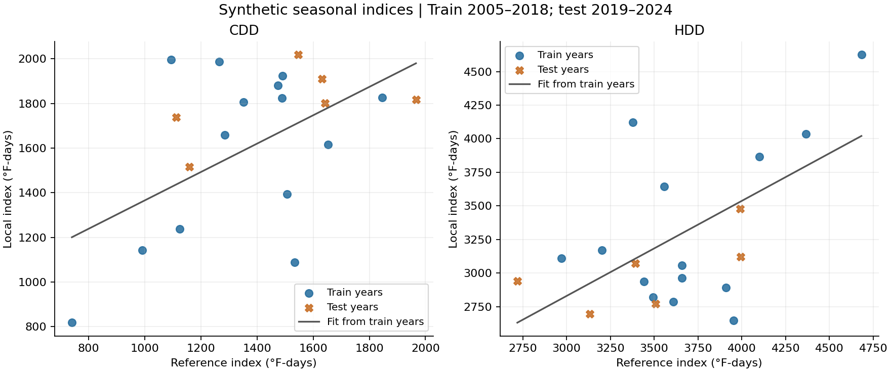
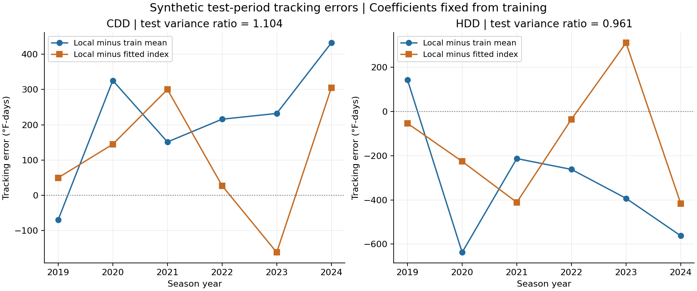

# Weather Hedging Demo

A small Python example of how a weather index at one location can leave tracking
error when used for another location. All temperatures are generated from scratch.
No real station observations, market data or research results are included.

## What it demonstrates

- Construct cooling/heating degree-day indices from daily mean temperatures.
- Require complete seasons and align both locations on the same dates.
- Fit a linear tracking relationship on earlier years and evaluate on later years.
- Show residual variance, mean tracking error and clear result units.

```text
Synthetic daily temperatures → seasonal CDD/HDD totals → chronological split
                                                            ↓
                                        train fit → later-year test → plots
```

## Quick start

Python 3.11+ is required. The dependencies are NumPy and Matplotlib.

**Windows PowerShell**

```powershell
python -m venv .venv
.\.venv\Scripts\python.exe -m pip install -e .
.\.venv\Scripts\weather-hedging-demo.exe run demo_output/run-01
.\.venv\Scripts\weather-hedging-demo.exe verify demo_output/run-01
.\.venv\Scripts\python.exe -m unittest discover -s tests -v
```

**macOS / Linux**

```bash
python3 -m venv .venv
.venv/bin/python -m pip install -e .
.venv/bin/weather-hedging-demo run demo_output/run-01
.venv/bin/weather-hedging-demo verify demo_output/run-01
.venv/bin/python -m unittest discover -s tests -v
```

These commands use explicit environment paths; activation is not required.
Use a new run name each time. Existing output directories are not overwritten.
Without installing the package, `python scripts/run_demo.py run demo_output/run-01`
also works if the two dependencies are already available.

## Definitions and split

Daily mean temperature is `(TMAX + TMIN) / 2`, measured in °F. With base 65°F:

```text
CDD_day = max(Tmean - 65, 0)
HDD_day = max(65 - Tmean, 0)
```

CDD totals cover June–September of the labelled year. HDD totals cover
October–March and are labelled by the year containing January: winter 2024
includes October 2023 through March 2024. Leap days are included. Every selected
season must contain all required dates at both fictional locations; missing dates
fail the run instead of being imputed or silently dropped.

The example fixes 20 synthetic season-years, 2005–2024:

| Split | Season-years | Paired observations per index |
|---|---|---:|
| Training | 2005–2018 | 14 |
| Test | 2019–2024 | 6 |

The dates are invented labels, not observed historical temperatures. Actual weather
dates used for training end before any test season begins. No coefficient or parameter
is selected based on test performance. This toy example is not a pre-registration.

## Fit and comparison

Let `X` be the reference index and `Y` the local index. On training years only:

```text
beta = Cov(X_train, Y_train) / Var(X_train)
alpha = Mean(Y_train) - beta * Mean(X_train)
```

Keep these coefficients fixed for test years. Compare:

```text
baseline_error = Y_test - Mean(Y_train)
tracking_error = Y_test - (alpha + beta * X_test)

residual_variance_ratio = Var(tracking_error) / Var(Y_test)
variance_reduction_fraction = 1 - residual_variance_ratio
```

Both variances use the same test season-years and `ddof=1`. Ratios above one
and negative variance reductions are retained: a fitted relationship can do worse
than the baseline out of sample. Zero test-index variance fails rather than yielding
an undefined ratio. Mean tracking error is reported separately because variance
does not capture a constant bias.

Each test estimate is a descriptive statistic from only six synthetic paired years.
No confidence interval or claim of statistical significance is made.

## Outputs

Each successful run contains:

- `synthetic_daily.csv`: generated high/low temperatures for LOCAL and REFERENCE.
- `seasonal_indices.csv`: 40 paired rows, 20 each for CDD and HDD.
- `predictions.csv`: train/test labels, fitted values and both error series.
- `results.json`: coefficients, test metrics, units, denominator and synthetic era.
- `index_relationship.png`: train/test points with the training-period fit.
- `test_tracking_errors.png`: baseline and fitted-index errors on test years.
- `run_manifest.json`: parameters, runtime, code hashes and output file hashes.

Files are produced in a staging directory and verified before the directory is
published under its run name. A handled failure leaves diagnostics without a complete
manifest. Verification requires supported manifest metadata (parameters, runtime
versions and code hashes) as well as matching artifact hashes. Hash verification is
an integrity check, not a signed authenticity guarantee.

## Tests

Tests cover mean-temperature degree days, season labels, leap years, missing/duplicate
days, exact linear fits, chronological separation, test-data changes, ratios above one,
constant bias, degenerate samples, deterministic inputs, output tampering and failed runs.
Missing or invalid manifest metadata and numerical overflow are also rejected.
See [VALIDATION.md](VALIDATION.md) for the local validation record and limits.

## Scope

This illustrates index tracking and geographic mismatch. It does not price a tradable
contract, estimate premiums/fees, model firm losses or establish hedge profitability.
The invented shared/local temperature shocks are not a validated climate model.
No private repository is imported or included; results are not evidence about any
exchange's weather contracts. This example runs independently of the research project.

## Example figures

These images were generated with the default seed (7). Blue circles mark training
years; orange crosses mark later test years. The grey line is fitted on training
years only.



The error plot compares the training-mean baseline with the fixed linear fit.
The default CDD fit has a test variance ratio above one; that failed reduction
is kept. Each ratio uses six synthetic test season-years and the variance of the
local index on those same years as its denominator.



## License

MIT License. Copyright (c) 2026 Ziye Luo. See [LICENSE](LICENSE).

The license covers this standalone demo's code, documentation and generated
example figures. Dependencies retain their own licenses.

